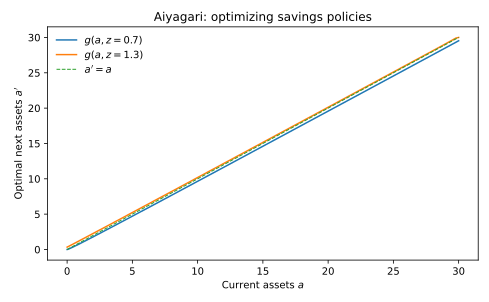
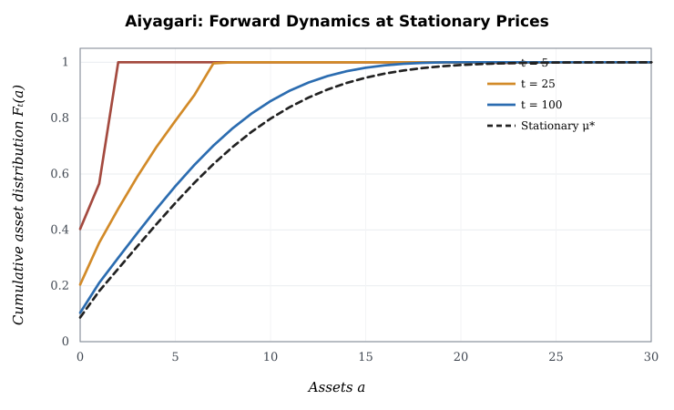

**本講義の研究対象。** Huggett (1993)、Aiyagari (1994)、Krusell and Smith (1998)、Achdou, Han, Lasry, Lions and Moll (2022) を経済学の出発点とする。標準的な貯蓄の最適化から分布の時間発展を導き、何がMarkov作用素の数学的性質であり、何が市場均衡の追加条件かを証明する。本稿では離散時間モデルと連続時間モデルを**異なる経済**として明記する。定理の証明に有限資産グリッドを使う場合は、それを無限状態の原著の定理と取り違えない。

主要原著：[Aiyagari (1994)](https://doi.org/10.2307/2118417)、[Huggett (1993)](https://doi.org/10.1016/0165-1889(93)90024-M)、[Krusell and Smith (1998)](https://doi.org/10.1086/250034)、[Achdou et al. (2022)](https://doi.org/10.1093/restud/rdab002)。

## 1. 経済：状態、情報、順序、技術

家計の集合は質量1の連続体で、家計状態は資産$a_t\in[\underline a,\infty)$と労働効率$z_t\in\mathcal Z=\{z_1,\ldots,z_J\}$である。期首に$(a_t,z_t)$が判明し、その時点で賃金$w_t$、資本の純収益率$r_t$、将来の価格系列に関する予想の下で消費$c_t>0$と期末資産$a_{t+1}$を選ぶ。期末に$z_{t+1}$が確率$P_z(z_t,z_{t+1})$で決まり、独立した個別ショックが到来する。$P_z$は行確率行列、すなわち非負で各行和が1である。集計ショックはまず存在せず、価格は定常状態で一定とする。

家計は雇用効率$z$を非弾力的に供給し、個別所得を完全には保険できない。単一の資産は、各期の生産に用いる資本への請求権である。期首に資産の純収益$r_t$を受け取り、予算制約は

$$
c_t+a_{t+1}=(1+r_t)a_t+w_tz_t,\qquad a_{t+1}\ge\underline a.
$$

$\beta\in(0,1)$、相対的危険回避度$\gamma>0$のもと、

$$
\max_{\{c_t,a_{t+1}\}}\;
E_0\sum_{t=0}^{\infty}\beta^t u(c_t),\qquad
u'(c)=c^{-\gamma},\qquad u''(c)=-\gamma c^{-\gamma-1}<0.
$$

$\gamma\neq1$なら$u(c)=c^{1-\gamma}/(1-\gamma)$、$\gamma=1$なら$u(c)=\log c$とし、効用の加法定数は価値の差に影響しない。借入下限は自然借入限度か、より厳しい外生制約とする。所得系列の支持と$1+r_t>0$により実行可能な正の消費が存在することを仮定する。

企業は$Y_t=AK_t^\alpha L_t^{1-\alpha}$、$\alpha\in(0,1)$、減耗$\delta\in(0,1)$の技術を持ち、競争的な利潤最大化問題

$$
\max_{K,L\ge0}\;AK^\alpha L^{1-\alpha}-(r+\delta)K-wL
$$

を解く。内点のFOCを各投入量で微分すると、

$$
\begin{aligned}
\partial_K\Pi&=\alpha AK^{\alpha-1}L^{1-\alpha}-(r+\delta)=0,\\
\partial_L\Pi&=(1-\alpha)AK^\alpha L^{-\alpha}-w=0,
\end{aligned}
$$

したがって$L>0$に対して

$$
r(K,L)=\alpha A(K/L)^{\alpha-1}-\delta,\qquad
w(K,L)=(1-\alpha)A(K/L)^\alpha.
$$

規模に関して一次同次なのでEuler定理から$Y=(r+\delta)K+wL$、利潤はゼロである。この価格式は家計の最適化の結果ではなく企業の最適化から生じる。

## 2. Bellman方程式を動的計画原理から得る

定常価格を一時的に固定し、当期の資源を$b(a,z)=(1+r)a+wz$と書く。時点0からの実行可能計画の集合を$\mathscr F(a,z)$とする。最初の行動$a'$を所与にすると当期消費は$c=b-a'$であり、残りの最適化は状態$(a',z')$から始まる問題に等しい。従って

$$
\begin{aligned}
V(a,z)
&=\sup_{\mathscr F(a,z)}E_0\left[u(c_0)+\sum_{t\ge1}\beta^t u(c_t)\right]\\
&=\sup_{a'\in\Gamma(a,z)}
\left\{u(b(a,z)-a')
+\beta\sum_{z'}P_z(z,z')V(a',z')\right\},
\end{aligned}
$$

ここで$\Gamma(a,z)=\{a'\ge\underline a:b(a,z)-a'>0\}$である。最後の等号は、$a'$を決めた後の継続問題がもとの問題と同じ型であることと、時間整合的な最適化の原理を使う。

**命題I.1（有限グリッドでのBellman解の一意性）。** 有限の資産・所得状態と各状態で有限の正の消費を生む非空選択集合、 boundedな当期効用、$\beta<1$を仮定する。Bellman作用素$T$には唯一の固定点がある。

**証明。** 任意の二つの有界関数$V,W$に対し、状態$(a,z)$で各候補選択の継続価値差は

$$
\left|\beta\sum_{z'}P_z(z,z')[V(a',z')-W(a',z')]\right|
\le\beta\|V-W\|_\infty.
$$

任意の数列$A_i,B_i$について$|\max A_i-\max B_i|\le\max|A_i-B_i|$だから、$\|TV-TW\|_\infty\le\beta\|V-W\|_\infty$となる。有限次元の完備ノルム空間でBanach縮小写像定理を適用すると唯一の固定点が存在する。これは**有限状態の補助命題**であり、CRRA効用が下方非有界になる連続状態の原著に直接適用したものではない。$\square$

## 3. Envelope、Euler、KKTを省略せず導く

$\Gamma(a,z)$の内部で最適解が存在し、$V(a,z)$が適切に微分可能で凹とする。現在の選択$a'$について目的関数

$$
F(a';a,z)=u(b(a,z)-a')+\beta\sum_{z'}P_z(z,z')V(a',z')
$$

を定義する。$dc/da'=-1$だから連鎖律より

$$
\frac{\partial F}{\partial a'}=-u'(c)+\beta\sum_{z'}P_z(z,z')V_a(a',z').
$$

内点FOCは$\partial F/\partial a'=0$。一方、現在資産$a$で包絡定理を用いる。$db/da=1+r$、継続価値の次期資産$a'$に対する政策微分は内点FOCで相殺するから、

$$
\begin{aligned}
V_a(a,z)
&=u'(c)\frac{\partial[b(a,z)-a']}{\partial a}
+\left[\frac{\partial F}{\partial a'}\right]\frac{\partial g(a,z)}{\partial a}\\
&=(1+r)u'(c).
\end{aligned}
$$

次期状態で同じ包絡条件$V_a(a',z')=(1+r)u'(c(a',z'))$を使うと、

$$
\begin{aligned}
u'(c(a,z))
&=\beta\sum_{z'}P_z(z,z')V_a(a',z')\\
&=\beta(1+r)\sum_{z'}P_z(z,z')u'(c(a',z'))\\
&=\beta(1+r)E[u'(c_{t+1})\mid a_t,z_t].
\end{aligned}
$$

これが**内点Euler等式**である。借入制約に拘束される家計へ無条件に当てはめてはいけない。

**命題I.2（上下のKKT不等式）。** 閉じた区間$[\underline a,\overline a]$への制約付き最大化が可能で、$F$が凹かつ一階微分可能であれば、最適資産$a'^*$は

$$
\begin{cases}
u'(c)=\beta E[V_a(a',z')] & \underline a<a'^*<\overline a,\\
u'(c)\ge\beta E[V_a(a',z')] & a'^*=\underline a,\\
u'(c)\le\beta E[V_a(a',z')] & a'^*=\overline a
\end{cases}
$$

を満たす。ここで消費正値の制約が追加で拘束されないとする。

**証明。** $a'^*=\underline a$では許される局所的変更は$da'\ge0$なので、最大点で方向微分$F'(\underline a)da'\le0$、よって$F'(\underline a)\le0$。先ほど求めた$F'=-u'(c)+\beta E V_a$を代入すると下限の不等式が得られる。上限では$da'\le0$しか許されず$F'(\overline a)\ge0$となるため、逆向きになる。内点は両方向の変更が許され$F'=0$である。$F$の凹性はこれらが大域最大の十分条件でもあることを保証する。$\square$

**横断性条件の役割。** Euler条件は局所的最適性の必要条件であり、それだけで無限期間の最適計画とはいえない。例えば無制約の内点モデルで、適切な可積分性、資産の非負性、価格の有界性を追加し、Lagrange乗数$\lambda_t=\beta^t u'(c_t)$を使うと、有限期間$T$の目的関数を摂動したときの未評価の端点項は$\lambda_T a_{T+1}$に比例する。この端点に価値を永久に残さない条件を

$$
\lim_{T\to\infty}E_0[\beta^T u'(c_T)a_{T+1}]=0
$$

と書く。借入可能、非定常価格、資産の符号が混在する場合の正確なTVCは別途調整が必要であり、この式を全ての経済に普遍的な定理としない。実際の数値解ではBellman残差と資源制約を併せて確認する。

## 4. EGMをEuler方程式から構築する

CRRAでは$u'(c)=c^{-\gamma}$だから内点Euler式は

$$
c^{-\gamma}=\beta(1+r)\sum_{z'}P_z(z,z')c(g(a,z),z')^{-\gamma}.
$$

次期資産を外生的な計算ノード$\widetilde a'$に固定し、その点で予想される次期限界効用

$$
\mathcal M(\widetilde a',z)=
\beta(1+r)\sum_{z'}P_z(z,z')
c_{\mathrm{old}}(\widetilde a',z')^{-\gamma}
$$

を計算すると、現在消費は限界効用の逆関数から

$$
c_{\mathrm{endo}}(\widetilde a',z)=\mathcal M(\widetilde a',z)^{-1/\gamma}
$$

となる。現在の予算式へ代入して

$$
a_{\mathrm{endo}}(\widetilde a',z)=
\frac{c_{\mathrm{endo}}(\widetilde a',z)+\widetilde a'-wz}{1+r}
$$

を得る。$(a_{\mathrm{endo}},c_{\mathrm{endo}})$の点を作り、現在の外生資産グリッド$a_j$へ単調な補間を行う。$a_j<a_{\mathrm{endo}}(\underline a,z)$では内点Euler条件を使わず、$a'=\underline a$と$c=(1+r)a_j+wz-\underline a$を直接課す。

**命題I.3（資産Lotteryの二つの保存則）。** 政策$a'=g(a_j,z)$が新分布グリッド$[a_0,\ldots,a_G]$に含まれ、隣接ノード$a_\ell\le a'\le a_{\ell+1}$の間で

$$
\theta_\ell(a')=\frac{a_{\ell+1}-a'}{a_{\ell+1}-a_\ell},\qquad
\theta_{\ell+1}(a')=\frac{a'-a_\ell}{a_{\ell+1}-a_\ell}
$$

の割合で確率質量を移す。このとき総確率質量と、移送される次期資産の第一モーメントが保存される。

**証明。** 両ウェイトは非負で和は1。したがって状態$(a_j,z)$の質量$f_{jz}$の総移送量は$f_{jz}(\theta_\ell+\theta_{\ell+1})=f_{jz}$。また

$$
\theta_\ell(a')a_\ell+\theta_{\ell+1}(a')a_{\ell+1}
=\frac{a_{\ell+1}-a'}{a_{\ell+1}-a_\ell}a_\ell+
\frac{a'-a_\ell}{a_{\ell+1}-a_\ell}a_{\ell+1}=a'.
$$

所得遷移$P_z(z,z')$の行和が1なので全所得状態に和をとっても二つの性質は維持される。$\square$

**数値上の重大条件。** 新グリッドが正の質量を持つ旧状態や到達可能な$g(a,z)$を包含していないとき、黙った切り捨て・端点への押し込み・再正規化によって第一モーメントを破壊してはならない。政策計算の**人工上限**を経済的制約に変更するか、計算範囲を拡大し、有限近似の違いを報告する。上限を拘束する場合は必ず$c=b-g$を再計算し、上限でのKKT不等式を検証する。

## 5. 個人の最適政策から分布のMaster Equationへ

時点$t$の分布を$\mu_t(da,z)$とし、最適政策$g_t(a,z)$に従うとする。家計が現在状態$(a,z)$であれば、次期状態は$(g_t(a,z),z')$であり、その条件付き確率は$P_z(z,z')$である。したがって任意の有界試験関数$\varphi$について反復期待値の法則により

$$
\begin{aligned}
E_{\mu_{t+1}}[\varphi]
&=E_{\mu_t}\left[E[\varphi(g_t(a,z),z')\mid a,z]\right]\\
&=\sum_z\int\sum_{z'}P_z(z,z')\varphi(g_t(a,z),z')\mu_t(da,z).
\end{aligned}
$$

分布の集合$B$に対して$\varphi=\mathbf1_B$を選ぶと

$$
\mu_{t+1}(B)
=\sum_z\int\sum_{z'}P_z(z,z')
\mathbf1_B(g_t(a,z),z')\mu_t(da,z).
$$

これがPushforwardを含む分布更新$\mu_{t+1}=\mu_t\mathcal P_{g_t}$の**導出**である。有限グリッドなら行確率行列$P_g$を使い$f_{t+1}=f_tP_g$、差分は$f_{t+1}-f_t=f_t(P_g-I)$。収益率と将来価格系列を固定した個人遷移が正しいことと、それらが経済全体で均衡になることは別である。

独立な個別所得ショックに対して条件付き大数の法則を適用できるなら、経験測度$\mu_t^N=N^{-1}\sum_i\delta_{(a_{it},z_{it})}$の線形汎関数はこの決定論的な期待値に収束する。しかし、相関した集計ショックや主体間の直接的なマッチングがある場合、この単純な条件付き独立性は失われる。

## 6. 連続時間の経済・HJBとGenerator

以下は[Achdou et al. (2022)](https://doi.org/10.1093/restud/rdab002)に関連する**連続時間の別経済**。効用割引率$\rho>0$、資産ドリフト$s(a,z,c)=ra+wz-c$、所得のPoisson遷移率$q_{zz'}\ge0$（$z'\neq z$）、$q_{zz}=-\sum_{z'\neq z}q_{zz'}$を仮定する。

時間幅$\Delta t$内の所得遷移は$P(z_{t+\Delta t}=z'\mid z_t=z)=q_{zz'}\Delta t+o(\Delta t)$、同じ所得にいる確率は$1+q_{zz}\Delta t+o(\Delta t)$。価値関数について動的計画原理は

$$
V(a,z)=\max_c\left\{u(c)\Delta t+
e^{-\rho\Delta t}E[V(a+s(a,z,c)\Delta t,z_{t+\Delta t})]\right\}+o(\Delta t).
$$

$V$が十分滑らかな内部でTaylor展開すると

$$
\begin{aligned}
e^{-\rho\Delta t}&=1-\rho\Delta t+o(\Delta t),\\
V(a+s\Delta t,z')&=V(a,z')+sV_a(a,z')\Delta t+o(\Delta t).
\end{aligned}
$$

同一所得状態への遷移が$1+O(\Delta t)$で、異なる所得への遷移と資産ドリフトの交差項は$O(\Delta t^2)$だから、

$$
E[V(a+s\Delta t,z_{t+\Delta t})]
=V(a,z)+\Delta t\left[sV_a(a,z)+\sum_{z'}q_{zz'}V(a,z')\right]+o(\Delta t).
$$

元の動的計画原理へ戻し、$V(a,z)$を両辺から差し引き、$\Delta t$で割って極限を取ると

$$
\rho V(a,z)=\max_{c>0}\left\{
u(c)+s(a,z,c)V_a(a,z)+\sum_{z'}q_{zz'}V(a,z')
\right\}.
$$

これはHJB方程式である。内点条件$u'(c^*)=V_a$、最適な資産ドリフト$s^*(a,z)=ra+wz-c^*(a,z)$が決まる。境界$a=\underline a$では**状態制約**$s^*(\underline a,z)\ge0$を満たすよう最適化集合を変更する。滑らかでない点では粘性解の概念を用いるが、この講義ではその一般的存在定理を証明済みと主張しない。

## 7. Forward EquationをGeneratorの随伴として導出

最適政策の下での生成作用素は、試験関数$\varphi(a,z)$に対して

$$
(\mathcal L\varphi)(a,z)
=s^*(a,z)\partial_a\varphi(a,z)+
\sum_{z'}q_{zz'}\varphi(a,z').
$$

これは

$$
\lim_{\Delta t\downarrow0}
\frac{E[\varphi(a_{t+\Delta t},z_{t+\Delta t})\mid a_t=a,z_t=z]-\varphi(a,z)}{\Delta t}
=\mathcal L\varphi(a,z)
$$

という定義に、上節のPoisson確率とTaylor展開を代入して得られる。分布$\mu_t$に対して任意の試験関数の期待を微分すると、

$$
\frac{d}{dt}\sum_z\int\varphi(a,z)\mu_t(da,z)
=\sum_z\int(\mathcal L\varphi)(a,z)\mu_t(da,z).
$$

内部で密度$g_t(a,z)$が存在し、境界項を別途管理するとする。資産ドリフト項を部分積分して

$$
\int s^*g_t\varphi_a\,da
=\left[s^*g_t\varphi\right]_{\underline a}^{\infty}
-\int\varphi\,\partial_a(s^*g_t)\,da.
$$

所得の遷移項は添字を交換して

$$
\sum_z\int g_t(a,z)\sum_{z'}q_{zz'}\varphi(a,z')\,da
=\sum_{z'}\int\varphi(a,z')\sum_zq_{zz'}g_t(a,z)\,da.
$$

境界流束を適切に処理した内部の密度について、任意の$\varphi$で積分が等しいことから

$$
\partial_tg_t(a,z)=
-\partial_a\left[s^*(a,z)g_t(a,z)\right]+
\sum_{z'}q_{z'z}g_t(a,z')
$$

を得る。**重要**：借入下限のDirac点質量があるときは、このPDEだけでは完結しない。例えば$\mu_t(da,z)=g_t(a,z)da+b_z(t)\delta_{\underline a}(da)$という分解を弱形式へ代入すれば、$b_z(t)$に境界への流入と所得状態のPoisson遷移を加えた質量保存式が必要になる。正確な境界規則は$s^*(\underline a,z)$の方向による。

**命題I.4（質量保存）。** 弱形式が成立し、無限遠への流出がなく、借入境界のフローを原子質量を含めて管理するなら、総質量$\sum_z\int\mu_t(da,z)$は一定である。

**証明。** 弱形式に$\varphi\equiv1$を代入する。資産微分$\varphi_a=0$かつ$Q_z\mathbf1=0$なので右辺は0となる。したがって総質量の時間微分は0である。$\square$

## 8. ItoからFokker–Planckを導く所得拡散への拡張

離散所得を変更し、**別のモデル**として対数労働効率$x=\log z$に

$$
dx_t=\kappa(\bar x-x_t)dt+\sigma dW_t,\qquad z_t=e^{x_t}
$$

を仮定する。これなら負の労働効率を防げる。資産のドリフトは$s(a,x)=ra+we^x-c(a,x)$である。試験関数$\varphi(a,x)$についてItoの公式を二次項まで展開すると、

$$
\begin{aligned}
d\varphi&=\varphi_a\,da+\varphi_x\,dx+\tfrac12\varphi_{xx}(dx)^2+o(dt)\\
&=\left[s\varphi_a+\kappa(\bar x-x)\varphi_x+\tfrac12\sigma^2\varphi_{xx}\right]dt+
\sigma\varphi_x\,dW_t,
\end{aligned}
$$

ここで$(dW_t)^2=dt$、$dt\,dW_t$と$(dt)^2$のIto次数は0である。期待値を取り、$dW_t$の確率積分の平均を0とし、試験関数に部分積分を一度・二度施すと

$$
\partial_tg=
-\partial_a(sg)-\partial_x[\kappa(\bar x-x)g]
+\tfrac12\sigma^2\partial_{xx}g.
$$

資産にはBrownianショックを直接入れていないので$\partial_{aa}g$は現れない。この式から総質量を導くには、$a$と$x$の端点の流束をゼロとする自然・反射境界等を追加する必要がある。

## 9. Stationary General Equilibriumの固定点

定常分布$g^*$、政策$c^*$、家計価値$V^*$、集計資本$K^*$、効率労働$L^*$、価格$(r^*,w^*)$について、以下が同時に必要である。(i) 与えられた価格に対する家計HJB・最適政策、(ii) その政策が誘導するForwardの定常解$\mathcal L_{g^*}^*\mu^*=0$、(iii) 生産の要素価格FOC、(iv) 資産市場$K^*=\int a\,d\mu^*$、(v) 効率労働$L^*=\int z\,d\mu^*$、(vi) 財市場$AK^{*\alpha}L^{*1-\alpha}=C^*+\delta K^*$。

この固定点を構成するには、ある仮の$K$から企業価格$(r(K),w(K))$を計算し、家計の最適政策$g_K$を解き、不変分布$\mu_K$を求め、資本供給

$$
\mathcal T(K)=\int a\,\mu_K(da,dz)
$$

を再計算する。**均衡条件は$\mathcal T(K)=K$**。Walras法則の下で市場がすべて整合することも予算会計から確認する。家計予算を積分し、定常下で$\int a'=\int a=K$を使うと

$$
C+K=(1+r)K+wL,\qquad
C=rK+wL=Y-\delta K.
$$

従って$Y=C+\delta K$は他の市場清算と企業FOCから従う。これは資源制約を単なる追加の独立方程式として重複させずに整合性を確認する方法である。

**Huggettとの違い**：純供給$B$の債券であれば$A^s=\int a\,d\mu=B$を清算し、生産技術から$r(K)$を決めるのではない。**Krusell–Smithとの違い**：集計ショックがあれば個人の価値関数は資産・個別所得だけでなく集計状態と将来の集計法則に依存する。平均資産だけの近似が有効なのは特定の数量的環境である。

## 10. Log–SumとKL Data Processingの完全な証明

正の数$a_i,b_i$について、$A=\sum_i a_i$、$B=\sum_i b_i$とする。$q_i=a_i/A$、$p_i=b_i/B$と置く。$\log x\le x-1$を各比率$x=p_i/q_i$へ適用すると、

$$
\begin{aligned}
\sum_iq_i\log\frac{p_i}{q_i}
&\le\sum_iq_i\left(\frac{p_i}{q_i}-1\right)\\
&=\sum_i(p_i-q_i)=0.
\end{aligned}
$$

従って$\sum_iq_i\log(q_i/p_i)\ge0$であり、

$$
\begin{aligned}
\sum_ia_i\log\frac{a_i}{b_i}
&=\sum_iAq_i\log\frac{Aq_i}{Bp_i}\\
&=A\log(A/B)+A\sum_iq_i\log(q_i/p_i)\\
&\ge A\log(A/B).
\end{aligned}
$$

これが**Log–Sum不等式の証明**。ゼロ成分は極限で処理する。

**命題I.5（KL Data Processing）。** $P$を有限状態の行確率行列、$f,\pi$を確率分布、$\pi P=\pi$、$D_{\mathrm{KL}}(f\Vert\pi)<\infty$とすると

$$
D_{\mathrm{KL}}(fP\Vert\pi)\le D_{\mathrm{KL}}(f\Vert\pi).
$$

**証明。** 各遷移先$j$にLog–Sum不等式を$a_i=f_iP_{ij}$、$b_i=\pi_iP_{ij}$として適用する。

$$
\begin{aligned}
\left[(fP)_j\right]\cdot\log\left(\frac{(fP)_j}{(\pi P)_j}\right)
&\le\sum_i\left[f_iP_{ij}\right]\cdot\log\left(\frac{f_iP_{ij}}{\pi_iP_{ij}}\right)\\
&=\sum_if_iP_{ij}\log\frac{f_i}{\pi_i}.
\end{aligned}
$$

両辺を$j$で合計し、$P\mathbf1=\mathbf1$と$\pi P=\pi$を用いる。

$$
\begin{aligned}
D_{\mathrm{KL}}(fP\Vert\pi)
&=D_{\mathrm{KL}}(fP\Vert\pi P)\\
&\le\sum_i f_i\left(\sum_jP_{ij}\right)\log\frac{f_i}{\pi_i}\\
&=D_{\mathrm{KL}}(f\Vert\pi).
\end{aligned}
$$

証明では詳細釣合い$\pi_iP_{ij}=\pi_jP_{ji}$を一度も使っていない。$\square$

**反例：非可逆でもKL縮小。** 三状態で$P_{12}=P_{23}=P_{31}=1$、それ以外の要素が0の循環行列をとる。一様$\pi=(1/3,1/3,1/3)$は不変だが、$\pi_1P_{12}=1/3$に対し$\pi_2P_{21}=0$なので詳細釣合いは成立しない。それでも命題I.5は成立する（この決定論的な巡回ではKLは**等号**であり、厳密な減少や混合は主張できない）。

**反例：分布依存核に同じ参照$\pi$を使えない。** 分布$f=(p,1-p)$に応じて両行が$(F(p),1-F(p))$となる核$P(p)$をとり、$F(p)=1/2+0.48\tanh[10(p-1/2)]$とする。$p=1/2$は固定点だが$F'(1/2)=4.8>1$なので近傍の摂動は増幅する。例えば$p=0.51$では$F(p)\simeq0.54784$となり、二値の$D_{\mathrm{KL}}((p,1-p)\Vert(1/2,1/2))$は増える。Data Processingが壊れたわけではない。比較すべき基準分布が$\pi P(p)$に変わり、$\pi P(p)\neq\pi$となるため、同一の$\pi$への単調性が結論できない。これは**Markov核の数学的な反例**であり、Aiyagariの均衡がそのような不安定性を持つと主張するものではない。

## 11. Detailed Balance、Entropy、Gibbsの経済的な意味

固定されたMarkov核で不変分布$\pi$を得ることと、ペアごとの流入流出が相殺するDetailed Balanceを得ることは別。更に$\pi_i\propto e^{-E_i/\tau}$という形式は、後から$E_i=-\tau\log\pi_i$と定義すれば任意の正分布について書ける。経済的に独立な効用・費用・ポテンシャルを使ってその形を**事前に導出**したときだけ構造的な意味がある。

Aiyagariの富分布は、最適貯蓄政策、借入制約、所得過程、資本市場清算で決まる。通常は富を保存するランダム交換模型でも、Gibbsの詳細釣合いを前提とした模型でもない。KL縮小は固定政策の有限Markov作用素についての数学的定理であり、厚生最大化や競争均衡の存在証明ではない。

## 12. 数値例・検証問題・原著との対応

[EGM・定常一般均衡の貯蓄政策](figures/aiyagari-savings.svg)と[分布のForward推移](figures/aiyagari-distribution.svg)をPythonで再計算する。最低限、$c+a'-(1+r)a-wz$、下限・上限KKT残差、$\mu P-\mu$、$\int a\,d\mu-K^d$、確率質量、Lotteryの第一モーメントの保存を**別々に**報告する。より粗い・細かいグリッドで均衡価格・Euler残差が安定するか確認する。数値残差が小さくても無限状態での存在・一意性を証明したことにはならない。

原著の位置づけは、Huggettが無リスク資産の市場均衡、Aiyagariが生産資本と予備的貯蓄、Krusell–Smithが集計ショックと近似集計法則、Achdou et al. が連続時間HJB–KF体系と理論・数値結果、という違いである。特にAchdou et al. の貧困家計に対する$\sqrt{a}$型の政策挙動、ある特殊ケースの定常分布の解析解、一定の弾力性条件での均衡一意性は、本文で証明していないので**原著の外部定理**とする。講義Iの証明済み命題は上で条件を明示したI.1–I.5である。
