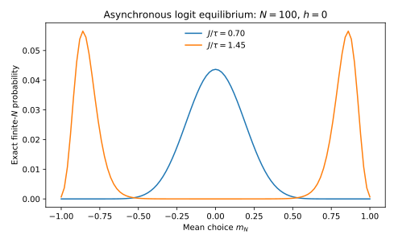

# Brock–DurlaufとBlume：最適離散選択からGibbs分布・相転移を導く

**大学院研究講義 II。** 既存の社会的相互作用モデルを用いて、ランダム効用→個人の最適離散選択→確率的戦略更新→ポテンシャル→有限人数の定常Gibbs測度→大人数極限の相転移を導く。[Blume (1993)](https://doi.org/10.1006/game.1993.1023)と[Brock and Durlauf (2001)](https://doi.org/10.1111/1467-937X.00168)は異なる問い・更新規則を持つ先行研究であり、以下は**両者と対応する明示的な対称モデル**である。[Kirman (1993)](https://doi.org/10.2307/2118498)は有限人数の模倣と群集行動を比較する基準となる。

## 1. Economic Primitives：社会的補完性を持つ選択

$N\ge2$人の個人$i$は$s_i\in\{-1,+1\}$を選択する。観察可能な私的便益$h$と、他人に同調することの便益$J\ge0$があり、**選択ショックを除いた**効用を
$$
u_i(s_i,\mathbf s_{-i})=
s_i\left[h+\frac{J}{N-1}\sum_{j\ne i}s_j\right]
$$
とする。この式は正の行動が常に効率的という仮定ではない。$J>0$で他人の選択と自分の選択が補完的になることを表す。企業の採用、集団への参加、技術選択などの単純化された経済的意思決定に対応する。

他人の平均$m_{-i}=(N-1)^{-1}\sum_{j\ne i}s_j$を所与とした二つの効用差は
$$
u_i(+1,\mathbf s_{-i})-u_i(-1,\mathbf s_{-i})=2(h+Jm_{-i}).
$$
各選択肢に独立なType-I Extreme Valueショック$\epsilon_i(+),\epsilon_i(-)$（同じ尺度$\tau>0$）を加え、個人が効用を最大化する。極値ショックの差がLogistic分布なので
$$
\boxed{
P_i(+1\mid\mathbf s_{-i})
=\frac{e^{(h+Jm_{-i})/\tau}}
{e^{(h+Jm_{-i})/\tau}+e^{-(h+Jm_{-i})/\tau}}
=\frac{1}{1+e^{-2(h+Jm_{-i})/\tau}}.
}
$$
したがって
$$
E[s_i\mid\mathbf s_{-i}]=
P_i(+1\mid\mathbf s_{-i})-P_i(-1\mid\mathbf s_{-i})
=\tanh((h+Jm_{-i})/\tau).
$$
ここにあるのは**実際に最大化したランダム効用のLogit確率**である。$\tau$は個人選択の異質性を表す尺度で、物理的な温度や時間割引因子ではない。

## 2. Stochastic Revision：同時選択と非同期更新は別モデル

ここからBlume型の確率的戦略更新を明示する。各期、一様に選ばれた個人$i$だけが、現在の他者選択$\mathbf s_{-i}$を条件に新しいGumbelショックを観察して選択し直す。他人の選択はその期には固定する。この**asynchronous logit best response**は有限状態$\{-1,+1\}^N$上のMarkov Chainを定める。

現在状態$\mathbf s$から$i$だけを反転した状態$\mathbf s^i$への遷移確率は
$$
P(\mathbf s,\mathbf s^i)=\frac1N
P_i(-s_i\mid\mathbf s_{-i})>0.
$$
自己ループもあり、すべての状態間は有限回の更新で到達できる。ゆえに有限$N$で既約・非周期的、定常分布は一意である。

個人のランダム効用による**一斉同時更新**であれば一般にはこの可逆Markov Chainとは異なり、同じ定常Gibbs測度は保証されない。均衡選択、同時Logit QRE、非同期の確率更新の不変測度は区別する。

## 3. Potential Game：経済的な効用差とポテンシャルの一致

次のポテンシャル関数を定義する。
$$
\boxed{
\Phi_N(\mathbf s)=h\sum_{i=1}^Ns_i+
\frac{J}{2(N-1)}\sum_{i\ne j}s_is_j
=hS+\frac{J}{2(N-1)}(S^2-N)
}
$$
ただし$S=\sum_i s_i$。個人$i$の選択を$s_i$から$s_i'$に変えると
$$
\Phi_N(s_i',\mathbf s_{-i})-\Phi_N(s_i,\mathbf s_{-i})
=(s_i'-s_i)\left[h+\frac{J}{N-1}\sum_{j\ne i}s_j\right].
$$
右辺はその個人の効用変化
$u_i(s_i',\mathbf s_{-i})-u_i(s_i,\mathbf s_{-i})$に**厳密に一致**する。よって対称的な相互作用のゲームはExact Potential Gameである。

相互作用行列が非対称$J_{ij}\ne J_{ji}$の場合、この同一式のポテンシャルが一般に存在しない。ポテンシャル性は「個人に他者の影響がある」というだけで自動的に成立しない。

## 4. Detailed BalanceからFinite-$N$ Gibbs Measure

候補分布を
$$
\boxed{
\pi_N(\mathbf s)=
\frac{\exp[\Phi_N(\mathbf s)/\tau]}{Z_N},
\quad
Z_N=\sum_{\mathbf s\in\{-1,+1\}^N}e^{\Phi_N(\mathbf s)/\tau}
}
$$
とする。$\mathbf s^i$が個人$i$のみ反転した状態なら、Logitのオッズ比とポテンシャル差の一致から
$$
\frac{P(\mathbf s,\mathbf s^i)}{P(\mathbf s^i,\mathbf s)}
=\exp\left(
\frac{\Phi_N(\mathbf s^i)-\Phi_N(\mathbf s)}{\tau}
\right)
=\frac{\pi_N(\mathbf s^i)}{\pi_N(\mathbf s)}.
$$
したがって
$$
\boxed{\pi_N(\mathbf s)P(\mathbf s,\mathbf s^i)
=\pi_N(\mathbf s^i)P(\mathbf s^i,\mathbf s)}.
$$
全ての単一反転ペアに対して成立するから詳細釣合いが成立し、$\pi_N$は不変分布である。有限$N$で既約なので唯一の定常分布でもある。$\square$

**重要な範囲：** 特定の同時性、対称的な効用相互作用、Logit更新を仮定した有限ゲームに対する証明である。任意の社会相互作用モデル、ネットワーク、学習ダイナミクスにGibbs測度があるわけではない。

## 5. Microstate Count、Boltzmann Entropy、Partition Function

マクロ状態を$m_N=N^{-1}\sum_i s_i=S/N$とする。正の選択者数$k$は$k=N(1+m)/2$。同じ$m$を持つミクロ状態の個数は
$$
W_N(m)=\binom{N}{k},\qquad k=\frac{N(1+m)}2.
$$
Stirling公式を使い、$N$が大きく$k/N$が内部にあれば
$$
\frac1N\log W_N(m)\to
H_B(m)=-\frac{1+m}{2}\log\frac{1+m}{2}
-\frac{1-m}{2}\log\frac{1-m}{2}.
$$
これが二値行動の**Boltzmann combinatorial entropy**。社会的な行動の分布がエントロピーを最大化する、という行動仮定ではない。

ポテンシャルが同一$m$の全ミクロ状態で等しいので有限人数の分配関数を厳密に集計できる。
$$
\boxed{
Z_N=\sum_{k=0}^N\binom Nk
\exp\left\{
\frac{h(2k-N)}{\tau}+
\frac{J[(2k-N)^2-N]}{2\tau(N-1)}
\right\}.
}
$$
したがって厳密な有限人数の$m$の確率は
$$
P_{\pi_N}(m_N=m)=
\frac{W_N(m)\exp[\Phi_N(m)/\tau]}{Z_N}.
$$
この式は有限$N$での正確な分布で、$m$を連続とみなす近似とは異なる。社会的相互作用のある経済で「多数のミクロ配置が典型的なマクロ状態を決める」という統計力学の命題が、個人効用から直接導かれた。

## 6. Large DeviationsとMean-Field Self Consistency

$N\to\infty$で$\Phi_N/N\to hm+Jm^2/2$。したがってLaplace原理の下でマクロ確率は
$$
P(m_N\simeq m)\asymp
\exp\left\{N\left[
H_B(m)+\frac{hm}{\tau}+\frac{Jm^2}{2\tau}-\sup_x\Psi(x)
\right]\right\},
$$
$$
\Psi(m)=H_B(m)+\frac{hm}{\tau}+\frac{Jm^2}{2\tau}.
$$
大偏差レート関数は
$$
\boxed{I(m)=\sup_{x\in[-1,1]}\Psi(x)-\Psi(m)\ge0.}
$$
典型的な集計選択は$\Psi$を最大化する。内部の一階条件は
$$
\Psi'(m)=-\operatorname{arctanh}(m)+\frac{h+Jm}{\tau}=0.
$$
よって
$$
\boxed{m=\tanh((Jm+h)/\tau).}
$$
これは大人数極限における**自己整合条件**であり、有限人数の平均$E[m_N]$が全ての$N$でこの式を厳密に満たすという主張ではない。

なお、大偏差関数の局所最小点は準安定的な分布の集中点となり得るが、グローバルに典型的なマクロ状態は**大域的な**最小点で決まる。単なる一階条件の複数解すべてが、平衡の確率質量を同程度に持つわけではない。

## 7. Phase TransitionとSocial Multiplier

対称ケース$h=0$では$m=0$が常に自己整合解。$\Psi''(m)=-1/(1-m^2)+J/\tau$より
$$
\Psi''(0)=J/\tau-1.
$$
$J/\tau<1$では$m=0$が唯一の大域最大点、$J/\tau>1$では$m=0$は局所最小点となり、$\pm m^*$が対称的な大域最大点になる。$J/\tau=1$はCurie–Weiss型の連続相転移点である。$\tanh x=x-x^3/3+O(x^5)$を使えば臨界近傍で
$$
(m^*)^2\simeq\frac{3(J/\tau-1)}{(J/\tau)^3},
$$
すなわち臨界指数$1/2$が得られる（**大人数・臨界近傍の漸近式**）。

自己整合式を$h$で暗黙微分すると
$$
\boxed{
\frac{\partial m}{\partial h}
=\frac{1-m^2}{\tau-J(1-m^2)}.
}
$$
$J(1-m^2)/\tau<1$という局所安定枝では、他者への反応が存在しない場合より社会的効果が増幅される。これが社会的乗数（social multiplier）の特殊な表現。

有限$N$では$\pi_N$は一意で滑らかな関数として存在し、$h=0$の有限人数平均$E_{\pi_N}[m_N]=0$は常に成り立つ。それにもかかわらず、$N$を増やすと分布が$\pm m^*$近傍に二峰性を持ち、両峰の間の移動が稀になり得る。この**準安定性**と均衡の非一意性を区別する。外部場$h$を先にゼロへ近づけるか、$N\to\infty$を先に行うかで選ばれる極限が違い得る。

## 8. Individual Equilibrium、Social Planner、Welfare

各個人が他人の$m$を所与として最適反応する条件と、社会計画者がすべての選択を同時に選ぶ条件は異なる。全員のショックを除いた効用の和は
$$
\sum_i u_i(\mathbf s)
=hS+\frac{J}{N-1}(S^2-N).
$$
一方、ポテンシャルは
$$
\Phi_N(\mathbf s)=hS+\frac{J}{2(N-1)}(S^2-N).
$$
相互作用項が**2倍異なる**。家計は自分の選択が他人の同調便益を変える影響を内部化しない。この比較は対称ゲームの具体的な外部性を示すが、Gibbs分布の最頻状態が常に厚生最大という主張を否定する。

市場価格・財・資産がないこのモデルの固定点を**競争的一般均衡**と呼んではならない。銀行取付・技術普及・企業選択に拡張するなら、それぞれの予算・契約・生産の市場条件が追加的に必要である。

## 9. Reflection ProblemとIdeal Experiment

$E[s_i\mid X_i,\bar s_{-i}]$が$\bar s_{-i}$と相関しても、模倣の因果効果$J$を識別できない。未観測の共通環境や同類的なネットワーク形成も同じ相関を生む。[Manski (1993)](https://doi.org/10.2307/2298123)のReflection Problemである。

**理想実験：** ランダム化した社会的情報を一部の隣人だけに与え、個人$i$への直接情報効果を排除したうえで、隣人の変化が$i$の行動・支出に及ぼす効果を推定する。ただし隣人の選択が内生的なら単純な比率は構造的な$J$に直結しない。先験的なネットワーク形成、局所的な共通ショック、選択ショック尺度$\tau$を別に識別する設計が必要となる。

比較静学としては相互作用が強いほど外生情報処置の局所伝播が増幅することと、ネットワークを断ち切ると効果が減衰することが候補。ただしモデルが予測するのは**変化の機構**であり、全ての観察された同調が模倣と断定できるわけではない。

## 10. 数値図・文献・研究評価

[有限人数の定常マクロ分布と相転移](figures/ising-finite-population.svg)は、上の$Z_N$を対数和指数関数で計算する**厳密な有限状態の理論分布**の可視化である。[再現Python](scripts/generate_figures.py)。有限人数の確率的更新のモンテカルロでは、観測時間の長さにより二峰性間の移動頻度が変わるため「観測されなかった移動」を不可逆な複数均衡と呼ばない。

**既存の結果：** Logit社会選択と複数自己整合解は[Brock and Durlauf (2001)](https://doi.org/10.1111/1467-937X.00168)、確率的戦略更新は[Blume (1993)](https://doi.org/10.1006/game.1993.1023)の研究系列。有限人数の同調移動は[Kirman (1993)](https://doi.org/10.2307/2118498)。**追加的な研究の可能性：** 資産制約と同調便益を同時に持つ家計が、政策ショックにどのような非線形な消費反応を示すか。ただしBrock–DurlaufとHANKの単なる組み合わせでは不十分で、相互作用×流動性制約による新しい比較静学と反例が必要である。

