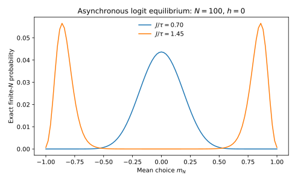

**出発点。** Blume (1993)の確率的戦略更新とBrock and Durlauf (2001)の社会的相互作用をもとに、講義用に対称な完全グラフの二択ゲームを構成する。この**明示的な特殊ケース**について、GumbelショックからLogitを積分計算し、ポテンシャル性を証明し、有限人数のGibbs分布、大人数の大偏差、相転移、社会的乗数、厚生を導出する。異なる原著の更新制度を同一の均衡概念とみなさない。原著：[Blume (1993)](https://doi.org/10.1006/game.1993.1023)、[Brock and Durlauf (2001)](https://doi.org/10.1111/1467-937X.00168)、[Kirman (1993)](https://doi.org/10.2307/2118498)、[Manski (1993)](https://doi.org/10.2307/2298123)。

## 1. 個人の選択問題：社会的補完性の経済的原始条件

$N\ge2$人の主体は同時点で$s_i\in\{-1,+1\}$という行動をとり、$h\in\mathbb R$は私的な選択便益、$J\ge0$は他者への同調便益である。他者の平均を$m_{-i}=(N-1)^{-1}\sum_{j\ne i}s_j$とし、確定的な効用を

$$
u_i(s_i,\mathbf s_{-i})=s_i(h+Jm_{-i})
$$

と定める。この式は、個人が他人の行動を所与として、二つの行動のどちらが好ましいかを選ぶ経済学的な目的関数である。直接微分ではなく二つの離散値を比較すると、

$$
u_i(+1,\mathbf s_{-i})=h+Jm_{-i},\quad
u_i(-1,\mathbf s_{-i})=-h-Jm_{-i},
$$

従って効用差は$u_i(+1)-u_i(-1)=2(h+Jm_{-i})$である。$J>0$なら他者が$+1$を選ぶほど自分の$+1$の相対便益が高まる。

これに私的選択ショック$\epsilon_i(+),\epsilon_i(-)$を加える。両ショックは独立で同一のType-I Extreme Value分布

$$
F_\epsilon(x)=\exp[-\exp(-x/\tau)],\qquad
f_\epsilon(x)=\frac1\tau\exp(-x/\tau)\exp[-\exp(-x/\tau)]
$$

に従い、尺度$\tau>0$、位置定数は二つの選択に同じため効用差から消える。各主体はショックを観測して$u_i(s_i)+\epsilon_i(s_i)$を最大化する。物理的な熱温度を仮定しているのではなく、ランダム効用に規定された個人最適化である。

## 2. GumbelからLogitを積分して導出

一般に確定効用$U_+$と$U_-$の差$\Delta=U_+-U_-$を定義すると、$+1$を選ぶ条件は$\epsilon_-\le\epsilon_++\Delta$である。独立性を使って条件付き積分すると、

$$
\begin{aligned}
P(+)
&=\int_{-\infty}^{\infty}
P(\epsilon_-\le e+\Delta)\,f_\epsilon(e)\,de\\
&=\int_{-\infty}^{\infty}
\exp[-\exp(-(e+\Delta)/\tau)]\,
\frac1\tau\exp(-e/\tau)
\exp[-\exp(-e/\tau)]\,de.
\end{aligned}
$$

ここで$t=\exp(-e/\tau)$と変数変換すると$de=-\tau\,dt/t$、積分の上下限は$\infty$から0へ逆転する。従って

$$
\begin{aligned}
P(+)
&=\int_0^\infty
\exp[-t\{1+\exp(-\Delta/\tau)\}]\,dt\\
&=\left[\frac{-\exp[-t\{1+\exp(-\Delta/\tau)\}]}{1+\exp(-\Delta/\tau)}\right]_{t=0}^{\infty}\\
&=\frac1{1+\exp(-\Delta/\tau)}.
\end{aligned}
$$

$\Delta=2(h+Jm_{-i})$を代入して

$$
P_i(+1\mid\mathbf s_{-i})
=\frac{\exp[(h+Jm_{-i})/\tau]}
{\exp[(h+Jm_{-i})/\tau]+\exp[-(h+Jm_{-i})/\tau]}.
$$

**命題II.1（条件付き平均行動）。** 上の確率的最適化では$E[s_i\mid\mathbf s_{-i}]=\tanh[(h+Jm_{-i})/\tau]$。

**証明。** $s_i$は$\pm1$なので条件付き平均は$P_i(+)-P_i(-)=2P_i(+)-1$。上の分数へ代入して

$$
2P_i(+)-1
=\frac{\exp(x)-\exp(-x)}{\exp(x)+\exp(-x)}
=\tanh x,\qquad x=(h+Jm_{-i})/\tau.
$$

$\square$。この段階は個人の条件付き選択確率の導出であり、集計期待と整合する均衡の導出はまだ行っていない。

## 3. 戦略更新過程とPotential Gameの証明

各離散時点に独立に一人の更新者$i$を一様抽出し、他者の現行行動を固定して再びGumbelショックを抽選して最適行動へ更新する。$N$人全員が同時更新するゲームとは別のMarkov Chainである。ミクロ状態を$\mathbf s=(s_1,\ldots,s_N)$、$i$だけ符号を反転した状態を$\mathbf s^i$とし、

$$
P(\mathbf s,\mathbf s^i)=\frac1N P_i(-s_i\mid\mathbf s_{-i})
$$

と定める。どの二状態も一人ずつ更新する有限経路で結ばれ、Logit確率は厳密に正だから既約。個人が現在の行動を選び直す確率も正なので、全状態に自己ループがあり非周期的。有限の既約・非周期Markov鎖は一意の不変分布を持ち、任意初期分布から収束する（後半は有限Markov鎖の既知の外部定理）。

**命題II.2（Exact Potential）。** 対称相互作用$J$を持つ上記ゲームでは

$$
\Phi_N(\mathbf s)
=h\sum_i s_i+\frac{J}{2(N-1)}\sum_{i\ne j}s_is_j
$$

がExact Potentialである。

**証明。** 任意の個人$i$が$s_i$から$s_i'$に変更すると、線形項は$h(s_i'-s_i)$変化する。二次の和において$i$を含む組$(i,j),(j,i)$の両方が現れ、係数$1/2$が二重計上を除くので、

$$
\begin{aligned}
\Delta_i\Phi_N
&=h(s_i'-s_i)+
\frac{J}{2(N-1)}\cdot2\sum_{j\ne i}(s_i'-s_i)s_j\\
&=(s_i'-s_i)(h+Jm_{-i})
=\Delta_i u_i.
\end{aligned}
$$

これはExact Potentialの定義そのものである。$\square$

**非対称相互作用の反例。** 二人のゲーム$u_1=s_1J_{12}s_2$、$u_2=s_2J_{21}s_1$を考え、$J_{12}\neq J_{21}$とする。主体1の選択差$u_1(+1,s_2)-u_1(-1,s_2)=2J_{12}s_2$を、$s_2=-1$から$+1$へ変えるとその差は$4J_{12}$変わる。同じ四つのゲーム状態を主体2からたどった場合は$4J_{21}$となる。Exact Potentialが存在すれば四角形の混合差は経路に依存しないはずなので$J_{12}=J_{21}$が必要。非対称な例では存在しない。

## 4. Detailed Balanceから有限人数のGibbs測度を証明する

分配関数$Z_N=\sum_{\mathbf s\in\{-1,+1\}^N}\exp[\Phi_N(\mathbf s)/\tau]$は有限正である。候補の定常分布を

$$
\pi_N(\mathbf s)=Z_N^{-1}\exp[\Phi_N(\mathbf s)/\tau]
$$

とする。対向する単一反転遷移の比率について、更新者$i$を選ぶ確率$1/N$が相殺し、Logitの二つの選択確率の比率は

$$
\begin{aligned}
\frac{P(\mathbf s,\mathbf s^i)}{P(\mathbf s^i,\mathbf s)}
&=\frac{P_i(-s_i\mid\mathbf s_{-i})}{P_i(s_i\mid\mathbf s_{-i})}\\
&=\exp\left[\frac{u_i(-s_i,\mathbf s_{-i})-u_i(s_i,\mathbf s_{-i})}{\tau}\right]\\
&=\exp\left[\frac{\Phi_N(\mathbf s^i)-\Phi_N(\mathbf s)}{\tau}\right]\\
&=\frac{\pi_N(\mathbf s^i)}{\pi_N(\mathbf s)}.
\end{aligned}
$$

**命題II.3（有限人数の可逆性と一意Gibbs分布）。** 上のゲームと非同期Logit更新の下では、$\pi_N$は唯一の定常分布であり、Detailed Balanceを満たす。

**証明。** 上式を交差乗算すれば$\pi_N(\mathbf s)P(\mathbf s,\mathbf s^i)=\pi_N(\mathbf s^i)P(\mathbf s^i,\mathbf s)$。それ以外の異なる二状態間の直接遷移確率は両方向とも0。すべての状態間でDetailed Balanceが成り立つため、各状態への確率流入総量は流出総量に等しく$\pi_NP=\pi_N$。前節で証明した既約性より定常分布は一意である。$\square$

ここでGibbs測度が出現する理由は**個人の効用の正確なPotential性と選択オッズの指数形**であり、すべての経済主体がEntropyを目的関数としているからではない。同時更新、非対称ゲーム、一定でない状態依存の更新者選択では、この証明は再利用できない。

### 4.1 一斉同時更新ではGibbs測度にならない：二人ゲームの反例

同じ効用関数と同じGumbelショックを使っても、更新のタイミングを変更すると定常分布が変わることを証明する。$N=2$、$h=0$、$J>0$とする。$k=J/\tau$、他者が$+1$を選んでいるとき自分が$+1$を選ぶ確率を$p=1/(1+e^{-2k})$、他者が$-1$のとき$+1$を選ぶ確率を$q=1-p$とする。

今回は二人が**同時に**相手の前期行動を観察し、それぞれ独立なGumbelショックを得て新しい行動を同時に決める。状態空間は$S=\{(++),(+-),(-+),(--)\}$。ある次期状態が$(++)$である確率を、四つの現在状態から順に計算すると、

$$
\begin{aligned}
P((++)\to(++))&=p^2,\\
P((+-)\to(++))&=qp,\\
P((-+)\to(++))&=pq,\\
P((--)\to(++))&=q^2.
\end{aligned}
$$

これらの和は$(p+q)^2=1$。行動符号を入れ替える対称性から、残りの三つの列も同様に列和1となる。すなわち同時更新の$4\times4$遷移行列はDouble Stochasticである。したがって一様分布$(1/4,1/4,1/4,1/4)$は不変であり、$p,q>0$で全状態間の一段階遷移が正なので唯一の不変分布となる。

**命題II.5（更新制度の反例）。** 上の二人同時Logit更新の唯一の定常分布は一様であり、$J>0$の非同期Logit更新から得られるGibbs分布ではない。

**証明。** 一様分布の不変性と一意性は直前の列和計算と既約性から従う。一方、同じゲームのPotentialは$\Phi_2=Js_1s_2$なので、Gibbs分布は同調状態$(++),(--)$に$e^{J/\tau}/Z$、非同調状態$(+-),(-+)$に$e^{-J/\tau}/Z$を置く。$J>0$なら両確率は等しくないため一様分布と一致しない。$\square$

したがって、同じ個人のランダム効用から同じLogit選択確率を得ても、経済全体の戦略更新方法が異なれば統計力学的な定常測度は変わる。**「LogitならGibbs」は偽**であり、「Exact Potentialと可逆性を満たす更新則ならGibbs」が正しい。

## 5. 配置数、Boltzmann Entropy、有限人数分配関数

$S_N=\sum_i s_i$、$m_N=S_N/N$、$k=(N+S_N)/2$を正の選択者数とする。$m_N=m$を実現するミクロ配置の数は、$N$人から正の選択者を$k$人選ぶ方法の数

$$
W_N(m)=\binom Nk=\frac{N!}{k!(N-k)!}
$$

である。$p=k/N=(1+m)/2$。Stirlingの公式$\log n!=n\log n-n+O(\log n)$をそれぞれの階乗に適用すると、

$$
\begin{aligned}
\frac1N\log W_N(m)
&=\frac1N[\log N!-\log(Np)!-\log(N(1-p))!]\\
&=-p\log p-(1-p)\log(1-p)+O(\log N/N)\\
&=:H_B(m)+O(\log N/N)
\end{aligned}
$$

を得る（内部の$p\in(0,1)$を固定）。$H_B(m)$は二値エントロピーであるが、効用そのものではない。

ポテンシャルの二次項は$\sum_{i\neq j}s_is_j=S_N^2-N$なので、$m=(2k-N)/N$を使うと、同じ$m$に属する全ミクロ状態のポテンシャルは

$$
\Phi_N(m)=Nhm+\frac{J}{2(N-1)}(N^2m^2-N).
$$

したがって全$2^N$状態の和を$N+1$個のマクロ状態へ正確に集約できる。

$$
Z_N=\sum_{k=0}^N
\binom Nk
\exp\left[
\frac{h(2k-N)}{\tau}
+\frac{J((2k-N)^2-N)}{2\tau(N-1)}
\right].
$$

有限人数での確率分布は$P_{\pi_N}(m_N=m)=W_N(m)\exp[\Phi_N(m)/\tau]/Z_N$。**有限$N$の厳密式**であり、次節の連続$m$による近似とは違う。

### 5.1 Gibbs分布の変分原理を最適化から証明する

有限のミクロ状態$\mathbf s\in S$に確率分布$p(\mathbf s)$を割り当て、Shannon Entropyを$H(p)=-\sum_{\mathbf s}p(\mathbf s)\log p(\mathbf s)$と定義する。Potentialは前節の$\Phi_N$とし、確率分布全体についての次の**数学的な**変分問題を考える。

$$
\max_{p\in\Delta(S)}
\left\{\sum_{\mathbf s}p(\mathbf s)\Phi_N(\mathbf s)+\tau H(p)\right\}.
$$

これは社会の実際の家計が直接解く目的関数ではない。有限状態の不変測度を特徴づけるために用いる変分表現である。

**命題II.6（Gibbs変分原理）。** $\tau>0$、有限状態$S$の下で、上の最大化問題の唯一の解は$\pi_N(\mathbf s)=e^{\Phi_N(\mathbf s)/\tau}/Z_N$であり、最大値は$\tau\log Z_N$。

**証明。** $\pi_N$は全状態で厳密に正なので、任意の確率分布$p$についてKL divergenceが定義できる。$\log\pi_N(\mathbf s)=\Phi_N(\mathbf s)/\tau-\log Z_N$を使うと、

$$
\begin{aligned}
\tau D_{\mathrm{KL}}(p\Vert\pi_N)
&=\tau\sum_{\mathbf s}p(\mathbf s)\log p(\mathbf s)
-\sum_{\mathbf s}p(\mathbf s)\Phi_N(\mathbf s)
+\tau\log Z_N\\
&=-\tau H(p)-E_p[\Phi_N]+\tau\log Z_N.
\end{aligned}
$$

従って

$$
E_p[\Phi_N]+\tau H(p)
=\tau\log Z_N-\tau D_{\mathrm{KL}}(p\Vert\pi_N).
$$

KL非負性は$\log x\le x-1$を用いて$-\sum p\log(\pi_N/p)\ge-\sum p(\pi_N/p-1)=0$と導ける。等号は$p=\pi_N$のときに限る。よって目的関数の最大値は$\tau\log Z_N$で、唯一の最大解は$\pi_N$。$\square$

この数学的な等価性から、経済主体が実際にEntropyを目的として最大化したことは**導けない**。個人の行動は第1–2節の確率的な効用最大化、社会的な不変測度は第3–4節の更新核によって定義されている。

## 6. Large Deviationsを組合せ式から導出

$\Psi(m)=H_B(m)+hm/\tau+Jm^2/(2\tau)$と定義する。前節の組合せ式から

$$
\frac1N\log\{W_N(m)e^{\Phi_N(m)/\tau}\}
=\Psi(m)+O(\log N/N)
$$

となる。$m$の値は$N+1$種類しかないので、最大項で分配関数の和を挟むと

$$
\max_m e^{N\Psi_N(m)}
\le Z_N\le(N+1)\max_m e^{N\Psi_N(m)},
$$

ここで$\Psi_N(m)=N^{-1}\log[W_N(m)e^{\Phi_N(m)/\tau}]$。対数を取って$N$で割ると、上界と下界の差は$\log(N+1)/N\to0$。従って

$$
\lim_{N\to\infty}\frac1N\log Z_N
=\sup_{m\in[-1,1]}\Psi(m).
$$

離散格子上の$m_N$がある内部点$m$の近傍へ入る確率の指数率は、

$$
P(m_N\simeq m)\asymp e^{-NI(m)},\quad
I(m)=\sup_x\Psi(x)-\Psi(m).
$$

これはこの有限状態のCurie–Weiss型模型の組合せ評価からの**大偏差率の導出**であり、任意の相互作用する一般経済に対するSanov型定理を証明したものではない。

内部の典型的な$m$は$\Psi'(m)=0$を満たす。$H_B'(m)$を直接微分すると

$$
\begin{aligned}
H_B'(m)&=-\frac12[\log((1+m)/2)+1]
+\frac12[\log((1-m)/2)+1]\\
&=\frac12\log\frac{1-m}{1+m}
=-\operatorname{arctanh}(m).
\end{aligned}
$$

したがって

$$
0=\Psi'(m)=-\operatorname{arctanh}(m)+(h+Jm)/\tau,
$$

両辺に双曲線正接を適用して、初めて

$$
m=\tanh((h+Jm)/\tau)
$$

が導かれる。ただし**一階条件を満たす全ての解が大域最大ではない**。下の臨界分析においてこの違いが重要である。

## 7. 相転移の存在、個数、局所安定性を証明する

$h=0$、$k=J/\tau$と書く。自己整合方程式は$m=\tanh(km)$で、$m=0$は常に解である。

**命題II.4（対称模型の解の個数）。** $k\le1$なら自己整合方程式の解は$m=0$のみ。$k>1$なら$0$と対称な非ゼロ解$\pm m^*$の3解が存在し、非ゼロの正の解は一意である。

**証明。** $m>0$について$\tanh(km)<km$。$k\le1$なら$\tanh(km)<km\le m$だから正の解はない。奇関数なので負の解もない。$k>1$では$f(m)=\tanh(km)-m$とすると$f(0)=0$、$f'(0)=k-1>0$、$f(1)=\tanh(k)-1<0$。よって中間値定理により$(0,1)$に正の解が存在する。$m>0$における$f''(m)=-2k^2\operatorname{sech}^2(km)\tanh(km)<0$から$f$は厳密凹、$f'(m)$は単調減少だから正のゼロ交差は一度だけ。負の解は対称性から従う。$\square$

レート関数を決める$\Psi''(m)=-1/(1-m^2)+k$より、$k<1$で$m=0$は局所最大、$k>1$で局所最小。非ゼロの外側の解は$\Psi''<0$を満たし局所最大となる。$h=0$では対称性から二つの大域最大が等高である。臨界点は$k=1$。

$tanh x=x-x^3/3+O(x^5)$を原点近傍に代入すると、

$$
m=km-\frac{k^3m^3}{3}+O(m^5)
\quad\Longrightarrow\quad
(m^*)^2=\frac{3(k-1)}{k^3}+O((k-1)^2).
$$

したがって秩序変数は$(k-1)^{1/2}$の速度で立ち上がる。これは指定した大人数極限の**漸近式**であり、有限人数に真の不連続な相転移を見つけたことを意味しない。

**局所安定性。** 期待平均行動を前期から更新する特定の平均場動学$m_{t+1}=\tanh((Jm_t+h)/\tau)$を別途考える。この写像の導関数は$k(1-m^2)$。従って$|k(1-m^2)|<1$なら線形近傍の摂動が縮小し、$>1$なら拡大する。これは**指定した動学**の安定性であり、有限人数の非同期Markov鎖の定常一意性とは別である。

## 8. External Field、Spinodal、社会的乗数

$J>\tau$で、自己整合条件の外生便益を$m$の関数として解くと

$$
h(m)=\tau\operatorname{arctanh}(m)-Jm.
$$

$dh/dm=\tau/(1-m^2)-J$がゼロになる点は$m=\pm r$、$r=\sqrt{1-\tau/J}$。$h(-r)=Jr-\tau\operatorname{arctanh}(r)>0$、$h(r)$は負。よって

$$
h_c=Jr-\tau\operatorname{arctanh}(r)
$$

がSpinodalの外場閾値である。$|h|<h_c$では自己整合方程式に3解、$|h|>h_c$では1解、境界$|h|=h_c$では接する重根が生じる（これらの結果は$h(m)$の極大・極小と単調性から従う）。重根と大域最大の間の切替は異なる点で起こり得るため、Spinodalを厚生的な最適均衡選択と呼ばない。

自己整合方程式$F(m,h)=m-\tanh((h+Jm)/\tau)=0$を微分すると

$$
F_m=1-\frac{J}{\tau}(1-m^2),\qquad
F_h=-\frac{1-m^2}{\tau}.
$$

$F_m\ne0$では陰関数定理を適用でき、$dm/dh=-F_h/F_m$だから

$$
\frac{\partial m}{\partial h}
=\frac{1-m^2}{\tau-J(1-m^2)}.
$$

$J>0$で安定な分枝では他者の反応の連鎖により社会的な反応が増幅する。分母がゼロへ近づくと局所感応度は発散し得るが、有限人数の期待値の導関数は有限である。

## 9. 有限人数の感応度と準安定性の区別

有限人数の分配関数を$Z_N(h)$とし、$\partial\Phi_N/\partial h=S_N$を使って微分すると

$$
\begin{aligned}
\frac{\partial\log Z_N}{\partial h}
&=\frac{1}{Z_N}\sum_{\mathbf s}
\frac{S_N(\mathbf s)}{\tau}e^{\Phi_N(\mathbf s)/\tau}
=\frac{E_{\pi_N}[S_N]}{\tau},\\
\frac{\partial^2\log Z_N}{\partial h^2}
&=\frac{E_{\pi_N}[S_N^2]-E_{\pi_N}[S_N]^2}{\tau^2}.
\end{aligned}
$$

よって有限$N$の集計平均について

$$
\frac{\partial E_{\pi_N}[m_N]}{\partial h}
=\frac{\operatorname{Var}_{\pi_N}(S_N)}{N\tau}\ge0.
$$

$Z_N$は有限個の解析的な正の指数関数の和なので、$\tau>0$、有限$N$で非解析的な自由エネルギーの相転移は起きない。$h=0$なら対称性により$E[m_N]=0$でも、$J/\tau>1$では分布の質量が$\pm m^*$周辺に二峰性で集中する。有限$N$で一意な不変分布を持つことと、有限の観測期間にはモードの間の移動が稀な準安定性は矛盾しない。遷移時間の指数オーダーを正確に主張するには可逆鎖のスペクトル・大偏差の追加理論が必要なので、ここでは未証明の一般定理として扱わない。

### 9.1 異質的な私的便益とMean-Fieldの一意性

これまでの対称模型では全員の私的便益を同じ$h$とした。所得、教育、採用技術、企業規模などの個別特性により$h_i$が異なり、その経験分布が大人数極限で$F_h$へ収束すると仮定する。各個人は集計平均$m$を所与として

$$
E[s_i\mid h_i,m]
=\tanh((h_i+Jm)/\tau)
$$

を選ぶ。全員の条件付き期待を平均して大人数の集計的整合性を課すと、Mean-Field方程式は

$$
m=\int_{\mathbb R}\tanh((h+Jm)/\tau)\,F_h(dh)
$$

となる。この式は異質的な経済環境に応じて積分の対象が変わり、完全な対称なIsing方程式と同じ解の個数を保証するものではない。

**命題II.7（異質的便益でも弱い社会的補完性なら一意）。** $J/\tau<1$、$F_h$が確率測度であり、右辺が定義できるとする。このMean-Field方程式は$[-1,1]$に唯一の解を持つ。

**証明。** $T(m)=\int\tanh((h+Jm)/\tau)\,F_h(dh)$と置く。$\tanh$の値は$[-1,1]$に入るため$T$は区間から自身への写像。平均値の定理と$\tanh'(x)=\operatorname{sech}^2x\le1$から任意の$m_1,m_2$で

$$
|T(m_1)-T(m_2)|
\le\int\frac{J}{\tau}|m_1-m_2|F_h(dh)
=\frac{J}{\tau}|m_1-m_2|.
$$

$J/\tau<1$なら縮小写像なのでBanachの定理から唯一の固定点が存在する。$\square$

逆に$J/\tau>1$なら必ず多重均衡になるとは言えない。たとえば全員の私的便益が十分に正方向へ強く偏れば、$m$が取り得る範囲における$\operatorname{sech}^2$が小さくなり、右辺の傾きが1未満となって一意性が回復し得る。これは**社会的相互作用の強さだけでなく、私的便益の分布が相転移を規定する**という経済学的な含意である。

## 10. 計画者の厚生と個人の外部性

確定的効用を全員について加算すると

$$
\begin{aligned}
W_N(\mathbf s)
&=\sum_i s_i h+\frac{J}{N-1}\sum_i\sum_{j\ne i}s_is_j\\
&=hS_N+\frac{J}{N-1}(S_N^2-N).
\end{aligned}
$$

一方、Potentialは$\Phi_N=hS_N+J(S_N^2-N)/[2(N-1)]$で、相互作用項が**半分**である。なぜなら主体$i$の行動変更は本人の同調利得に加え、他者$j$が感じる$i$への同調利得も変えるからである。両者の差を明示すると、

$$
W_N(\mathbf s)-\Phi_N(\mathbf s)
=\frac{J}{2(N-1)}(S_N^2-N).
$$

これは個人が自身の他者への効果を内部化しないことを示す。確率的なショックを含む期待厚生を計画者が最大化する場合は、ショック観察・情報集合と選択タイミングを新しく定める必要がある。この計算だけでGibbsの最頻値が社会的に最適とは言えない。

## 11. Reflection Problemを構造方程式から理解する

Manski型の識別問題を簡単な線形社会効果模型で考える。家計$i$の行動$y_i$、観測特性$x_i$、集団平均$\bar y_g,\bar x_g$について

$$
y_i=\alpha+\beta\bar y_g+\gamma\bar x_g+\delta x_i+u_g+\epsilon_i
$$

と仮定する（同じ集団平均に自身を含む単純化）。集団平均を取ると

$$
(1-\beta)\bar y_g=
\alpha+(\gamma+\delta)\bar x_g+u_g+\bar\epsilon_g.
$$

従って観測される集団平均回帰の傾きは$(\gamma+\delta)/(1-\beta)$。同じ傾きは異なる$\beta,\gamma,\delta$の組合せで生成できる。さらに$u_g$が存在すると集団共通ショックと内生的な模倣効果が観測的に混ざる。これがReflection Problemの基本的な識別障害の具体例である。平均行動の相関だけで$J$や社会的乗数を推定してはならない。理想実験はランダムな社会情報割当、相手の受け取る情報だけを変える設計などだが、直接効果を排除できるかが経済学的識別仮定となる。

### 11.1 反射問題のために必要な経済学的変動

前節の集団平均方程式

$$
\bar y_g=\frac{\alpha}{1-\beta}
+\frac{\gamma+\delta}{1-\beta}\bar x_g
+\frac{u_g+\bar\epsilon_g}{1-\beta}
$$

には$\beta$と$(\gamma+\delta)$が比率としてしか現れない。単なる集団レベルの観測値の数を増やしても、構造的な社会効果の同定条件は改善されない。必要なのは、本人の効用に直接影響せず、ある隣人の行動のみに影響する変動や、ネットワークの役割の非対称性を利用した追加の排除制約である。

しかし、隣人に対する情報処置が本人に直接見える場合、本人の情報環境も変わるため、単純なInstrumental Variableの排除制約は破れる。また、グループ形成が未観測の選好と相関すれば、処置を受ける隣人の選択も内生的である。モデルの$J$を推定できるかは、実際の観測変動が「誰の選択を外生的に変えたか」と、経済的に妥当な排除制約が一致しているかで判断する。

## 12. 数値計算・原著との対応

有限人数の$Z_N$は対数和指数で計算し、$\pi_N$の正規化、全単一反転ペアのDetailed Balanceを検証する。$J/\tau$を臨界前後で変えたときの$m_N$の正確な定常確率を図示し、数値シミュレーションの混合時間と区別する。

本講義で証明したII.1–II.4は、**対称な二択、完全グラフ、独立Gumbelショック、一人ずつの更新**という講義用特殊ケースの結果である。Brock–Durlauf原著の多重自己整合平均や識別の研究、Blume原著の格子状の相互作用と戦略改定、Kirmanの群集モデルを一つの同一モデルだと称しない。モデルの「相転移」が一般の市場均衡や厚生政策の結論に直結するわけではない。
