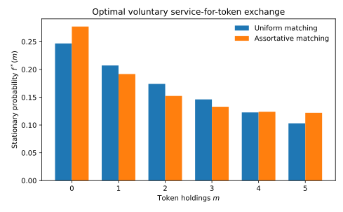

# Monetary SearchとBoltzmann方程式：最適な二者間取引の分布動学

**大学院研究講義 III。** 既存のMonetary Search Modelを出発点に、取引摩擦→個人のBellman最適化→双方の参加と交渉→状態遷移核→Boltzmann型分布方程式→貨幣・財・資本の均衡条件を導く。主要文献は[Kiyotaki and Wright (1989)](https://doi.org/10.1086/261634)、[Green and Zhou (1998)](https://doi.org/10.1006/jeth.1997.2356)、[Green and Zhou (2002)](https://doi.org/10.1111/1468-0262.00315)、[Lagos and Wright (2005)](https://doi.org/10.1086/429804)、[Rocheteau and Wright (2005)](https://doi.org/10.1111/j.1468-0262.2005.00568.x)、[Aruoba, Waller and Wright (2011)](https://doi.org/10.1016/j.jmoneco.2011.03.003)である。

## 1. 経済的原始条件と貨幣保有

個人が異なる財を専門的に生産・消費し、相手の欲しいものを自分が持たないことがある。匿名で信用・取引記録が利用できず、財が腐敗すれば、今の産出を将来の購買へ移す貨幣を保有する動機が生じる（double coincidence of wantsの欠如）。[Kiyotaki–Wright](https://doi.org/10.1086/261634)の主題はその貨幣の内生的役割である。

講義用の最小経済は、質量1の家計が非負のトークン$m\in\{0,\ldots,M\}$を持つ有限保有モデルである。これは古典論文の厳密な複製ではない。買手$b$は数量$q\ge0$の腐敗するサービスを消費し、効用$u(q)$を得る。売手$s$は$c(q)$の生産不効用を負い、買手から支払額$d$を受領する。実行可能性は
$$
0\le d\le b,\quad s+d\le M,\quad q\in\mathcal Q(b,s);
\qquad
(b',s')=(b-d,s+d).
$$
貨幣はペア間で保存されるがサービスは取引時に新規生産される。したがって貨幣保存は**所得・財の保存**ではない。

## 2. 個人最適化と参加制約

定常的な市場分布$f$と取引制度を所与として、家計の継続価値$V(m)$を考える。契約$(q,d)$の双方の取引前後の効用利得は、期末に状態価値を得るタイミングでは
$$
G_B(q,d;b)=u(q)+\beta[V(b-d)-V(b)],
$$
$$
G_S(q,d;s)=-c(q)+\beta[V(s+d)-V(s)].
$$
個人が拒否できるなら$G_B\ge0$かつ$G_S\ge0$が必要である。純粋なゼロサム貨幣移転で双方の価値が自己貨幣に厳密単調なら、この二条件は$d=0$を強制する。貨幣の移転を正当化するにはサービス・財・保険などの交換対象が不可欠である。

**固定価格契約**は$d=1,q=1$にあらかじめ制限する。その場合は$G_B(1,1;b)\ge0,G_S(1,1;s)\ge0$のときだけ取引する。**内生的Nash Bargaining**は、交渉力$\eta\in(0,1)$に対して
$$
\boxed{
\mathcal F_{b,s}(V)=\{(q,d):q\ge0,\ d\in\mathcal D_{b,s},\ G_B\ge0,\ G_S\ge0\},\\
(q^*,d^*)\in\arg\max_{(q,d)\in\mathcal F_{b,s}(V)}
G_B(q,d;b)^\eta\cdot G_S(q,d;s)^{1-\eta}.
}
$$
この最大化は連続・非分割貨幣、価格付けのタイミング、交渉失敗時の外部オプション、ゼロ利得の処理を指定して初めて完成する。内生交渉を追加するだけなら[Rocheteau and Wright (2005)](https://doi.org/10.1111/j.1468-0262.2005.00568.x)という先例が存在する。

## 3. Bellman方程式と合理的な分布期待

固定の最適取引政策$\chi(b,s)\in\{0,1\}$が個人にとって最適かを調べる。分布$f$は相手との遭遇率、したがって各状態での効用と遷移を決める。受容・交渉政策が導く一期間の遷移行列を$P(f,\chi)$、期待効用フローを$u_{\mathrm{flow}}(f,\chi)$とすれば
$$
\boxed{
V=u_{\mathrm{flow}}(f,\chi)+\beta P(f,\chi)V,
\qquad fP(f,\chi)=f.
}
$$
ここに$\sum_m f_m=1$、$\sum_m m f_m=\bar m$、全ての$(b,s)$での双方の最適性、サービス市場の生産・消費一致を加えたものが、固定価格制度の定常探索均衡の候補である。$f$だけの不変性を証明しても$V$の最適性は出てこない。活発な取引が成立する制度でも、全員が拒否する均衡が共存することがあるため、均衡選択は別問題である。

[Green and Zhou (1998, 2002)](https://doi.org/10.1111/1468-0262.00315)は分割可能貨幣、動学的取引、貨幣分布や価格の内生性を既に扱った。したがって固定価格の小さな貨幣グリッドを動かすこと自体は一般性の面で競争優位にならない。

## 4. 最適取引核とBoltzmann型の弱形式

状態$x,y$の個人が出会い、最適契約と双方の受容から事後状態$(x',y')$を生成する確率核を
$$
K^*(x,y;dx',dy'\mid V_t,f_t,p_t)
$$
と書く。これは経済的に許容される契約と均衡価格から**導くべき対象**である。出会い頻度$\lambda$、分子混沌による大人数極限の条件付き独立性を仮定すると、試験関数$\varphi$について
$$
\boxed{
\begin{aligned}
\frac{d}{dt}\int\varphi(x)f_t(dx)
={}&\frac{\lambda}{2}\iint f_t(dx)f_t(dy)\\
&\times\int K^*(x,y;dx',dy'\mid V_t,f_t,p_t)
[\varphi(x')+\varphi(y')-\varphi(x)-\varphi(y)].
\end{aligned}
}
$$
これがBoltzmann型Gain–Loss Operatorである。固定した$K^*$の下では$f\otimes f$の二次式だが、内生的な$V(f),p(f)$を介する場合には追加の非線形性を持つ。平均場極限を証明するにはマッチングの正規化、独立性、状態依存の政策の正則性と有限粒子数の誤差評価が必要であり、弱形式を書いただけでは収束定理は得られない。

$\varphi=1$を代入すれば質量保存、$\varphi(x)=m(x)$を代入し、各ペアで$m(x')+m(y')=m(x)+m(y)$を使えば貨幣保存が従う。サービスの生産量は取引の成立件数と数量$q$から別に集計する。

固定1トークン価格、買手$b\ge1$、売手$s<M$、マッチング重み$w(b,s)$なら、成功したペア取引頻度
$$
q_{bs}(f)=\frac{\lambda}{2}w(b,s)\chi(b,s)f_bf_s
$$
から
$$
\boxed{
\sum_m\varphi(m)Q_m(f)=
\sum_{b\ge1,s<M}q_{bs}(f)
[\varphi(b-1)+\varphi(s+1)-\varphi(b)-\varphi(s)].
}
$$
を得る。これは研究実装のStage 2に対応する**特定制度の厳密な記帳**。最適化付き取引からBoltzmann型方程式を得ることは、既に[Toscani, Brugna and Demichelis (2013)](https://doi.org/10.1007/s10955-012-0653-0)で示されているため、それ自体の新規性を主張してはならない。

## 5. 詳細釣合い、Entropy、非平衡定常状態

一期間の個人状態遷移が出生死亡過程のような隣接遷移だけで、有限かつ既約なら定常分布は詳細釣合いを満たす。しかし同じ経済に財の生産、信用、貨幣発行、複数の取引役割が入り、状態空間に非ゼロの循環流ができる場合は詳細釣合いを必ずしも満たさない。**定常性$fP=f$は可逆性の証明ではない。**

固定価格・一様マッチング・全取引受容の特別な場合、貨幣保有の上昇率と下降率はそれぞれ
$$
u_m=\lambda(1-f_0)/2,\qquad d_m=\lambda(1-f_M)/2
$$
となり、詳細釣合いから
$$
\boxed{f_{m+1}/f_m=(1-f_0)/(1-f_M)}
$$
となる。したがって定常分布は切断幾何分布$f_m\propto r^m$。一方、平均貨幣量と総人口のみを制約してShannon entropyを最大化すると$f_m^{ME}\propto e^{-\xi m}$。二つが一致するのは**この特別な出生死亡核**の帰結である。

保有額に依存するマッチングがこの単純比率を変えると、定常分布は平均貨幣制約付き最大Entropyから乖離し得る。Stage 2のAssortative Matchingで報告された値は$D_{\mathrm{KL}}(f\Vert f^{ME})=0.0060626683$。詳細釣合いが保たれていても、貨幣保有に線形な「エネルギー」を持つGibbs型分布になる必要はない。[Foley (1994)](https://doi.org/10.1006/jeth.1994.1018)のEntropyの対象は**取引集合上の取引分布**であり、貨幣保有分布のEntropyとは別である。

## 6. Quasi-Invariant TradeからFokker–Planckへの近似

小規模取引$\Delta m=\varepsilon\xi$で
$$
\varphi(m+\varepsilon\xi)-\varphi(m)
=\varepsilon\xi\varphi'(m)
+\frac{\varepsilon^2\xi^2}{2}\varphi''(m)+o(\varepsilon^2).
$$
マッチングの頻度も$\varepsilon$に応じて選び、第一・第二モーメントが有限の極限を持つとき、弱形式の極限は
$$
\partial_tf=-\partial_m[b(m,f)f]
+\tfrac12\partial_{mm}[D(m,f)f]
$$
というドリフト・拡散形式になる。頻度とショックのモーメントのスケーリングが必要であり、全てのBoltzmann方程式が同じFokker–Planck方程式に帰着するわけではない。特定の近似とその裾の研究は[Toscani et al. (2013)](https://doi.org/10.1007/s10955-012-0653-0)の研究対象である。

## 7. 生産・資本・貨幣の一般均衡と新規性の限界

家計の状態$x=(a,m,z)$、継続価値$V(x;\mu)$、最適貯蓄政策$g$、最適取引核$K^*$、企業の資本・労働需要を合わせるなら、分布動学の概念図は
$$
\boxed{\partial_t\mu=
\mathcal A_{g,p}^{*}\mu+
\mathcal Q_{K^*(V,\mu,p)}^{*}(\mu\otimes\mu).}
$$
前半$\mathcal A^*$は消費・貯蓄・所得・生産、後半$\mathcal Q^*$は最適な二者間取引を表す。これは**研究モデル案**であり、一般均衡として解けることは未証明。家計の共同予算制約、貨幣の実質購買力、財・労働・資本・貨幣市場の清算、将来の集計法則の合理的期待整合性を課す必要がある。

既存Stage 2は、非交換可能なトークンと資本を**加法分離**した直積経済であり、共同貨幣・資本Bellman、資本と貨幣の交換、共通労働、Nash bargainingは未完成。したがって完全統合型HANKとは呼べない。[Aruoba, Waller and Wright (2011)](https://doi.org/10.1016/j.jmoneco.2011.03.003)は貨幣、資本、分散市場の交渉を既に結びつけている。

新しい研究の中心的な問いは、**最適な二者間取引が生む内生的な流動性分布の変化によって、既存のMonetary Search経済にない資本蓄積・厚生の比較静学が発生するか**である。マッチング強度$\lambda$に対する$K^*$の反応のうち、貨幣分布を固定した場合には現れないフィードバックを識別する。非ゼロの資本反応やNash bargainingの導入だけでは新規性の根拠にならない。

[最適受容を伴う貨幣分布の数値図](figures/monetary-matching.svg)と[再現用Python](scripts/generate_figures.py)は限定された固定価格取引の教育用例であり、Nash bargainingや完全統合一般均衡の計算結果とは区別する。

## Appendix A. 交渉問題の内点一階条件

貨幣保有が連続的で$V(m)$が微分可能、$u'(q)>0$、$c'(q)>0$とする。買手・売手の参加利得$G_B,G_S$がともに正で、契約$(q,d)$の上限・下限に拘束されないとする。Nash積の対数を最大化すると
$$
\max_{q,d}\{\eta\log G_B(q,d;b)+(1-\eta)\log G_S(q,d;s)\}.
$$
内点でのサービス数量$q$の一階条件は
$$
\boxed{\frac{\eta u'(q)}{G_B(q,d;b)}
=\frac{(1-\eta)c'(q)}{G_S(q,d;s)}.}
$$
貨幣移転$d$の一階条件は
$$
\boxed{\frac{\eta V'(b-d)}{G_B(q,d;b)}
=\frac{(1-\eta)V'(s+d)}{G_S(q,d;s)}.}
$$
後者で$\beta$が消えるのは、買手と売手の限界継続価値がともに同じ割引率$\beta$を持つという**この講義用契約タイミング**による。貨幣の非分割性、参加制約が拘束される状況、$d=b$、$s+d=M$ではこれらの内点式を課さず、元の制約付き最大化問題を解く。交渉の問題を明示したことと、資本・貨幣の一般均衡を完成したことは異なる。

## Appendix B. 衝突作用素の正規化と保存則

無順序の家計ペアが遭遇し、各ペアの買手・売手を確率$1/2$で割り当てる。無限集団の分布$f$から二人の事前状態を独立抽出する制度の下では、全順序ペアを二重に数える分を除いて$\lambda/2$の係数が現れる。ただし**役割をあらかじめ順序づけたペア核**を使用する場合は係数を組み替える必要がある。実装と数式で「一人当たり遭遇頻度」の定義を一致させる。

ペアが取引後$(x',y')$へ移るとき、任意の$\varphi$について
$$
\langle \mathcal Q(f),\varphi\rangle
=\frac{\lambda}{2}\iint
f(dx)f(dy)\int K^*(x,y;dx',dy')
[\varphi(x')+\varphi(y')-\varphi(x)-\varphi(y)].
$$
$\varphi\equiv1$で括弧は$1+1-1-1=0$、$\varphi(x)=m(x)$で括弧は$m(x')+m(y')-m(x)-m(y)=0$。従って総人口と総貨幣は厳密に保存する。しかし一般の$\varphi(x)=a(x)$（資本）、$\varphi(x)=u(x)$（効用）については保存しない。この区別をつけたまま生産・消費・資本市場清算を追加する必要がある。

## Appendix C. 有限貨幣グリッドの不変性、予算、政策検証

全取引受容、固定価格1トークン、一様マッチングという特殊ケースで、状態$m\in\{0,\ldots,M\}$の出生死亡率は
$$
b_m=\frac{\lambda}{2}(1-f_0)\mathbf1\{m<M\},
\qquad
d_m=\frac{\lambda}{2}(1-f_M)\mathbf1\{m>0\}.
$$
固定された$f$に対する出生死亡過程では、$f_m b_m=f_{m+1}d_{m+1}$が詳細釣合いの必要十分なペア流条件である。従って$f_{m+1}/f_m=(1-f_0)/(1-f_M)$となる。ただし、$f$はこの遷移率に**自分自身が入る**非線形固定点であり、さらに正規化と貨幣総量$\bar m$が比率を決める。この切断幾何分布の導出は、すべてのMatching KernelにGibbs測度があるという主張ではない。

数値のBellman式を$V=u_{\mathrm{flow}}+\beta PV$とすると、$P$は行和1・非負でなければならない。$P=I+L$という離散時間のマッチング近似では、出会い率が高すぎて対角項が負になる可能性があるため、$P\ge0$を実際に検証する。固定契約の内生的受容は$G_B,G_S\ge0$を全ての実行可能ペアで評価する。小さい定常残差だけでは参加制約を保証しない。

固定価格・外生的トークン保有上限の経済から、貨幣と資本を自由に転換できる一般均衡へ移るには、財の貨幣価格、インフレ・貨幣発行の政府予算、資産市場、共通の生産労働、合理的な価格期待を新たに整合させる必要がある。Stage 2-Bの研究拡張に関する存在・一意性・新しい比較静学は**未証明**である。
